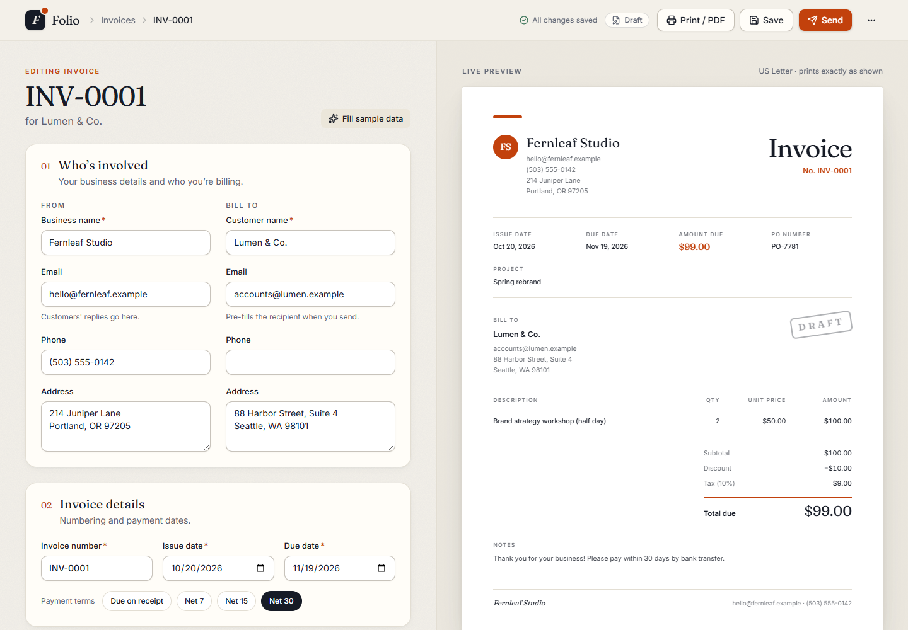
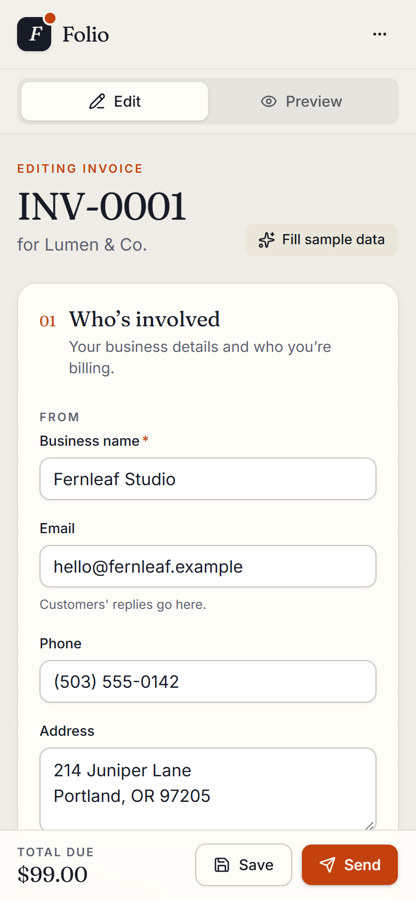
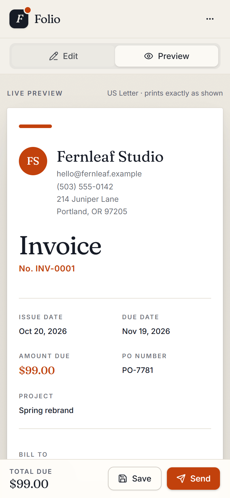
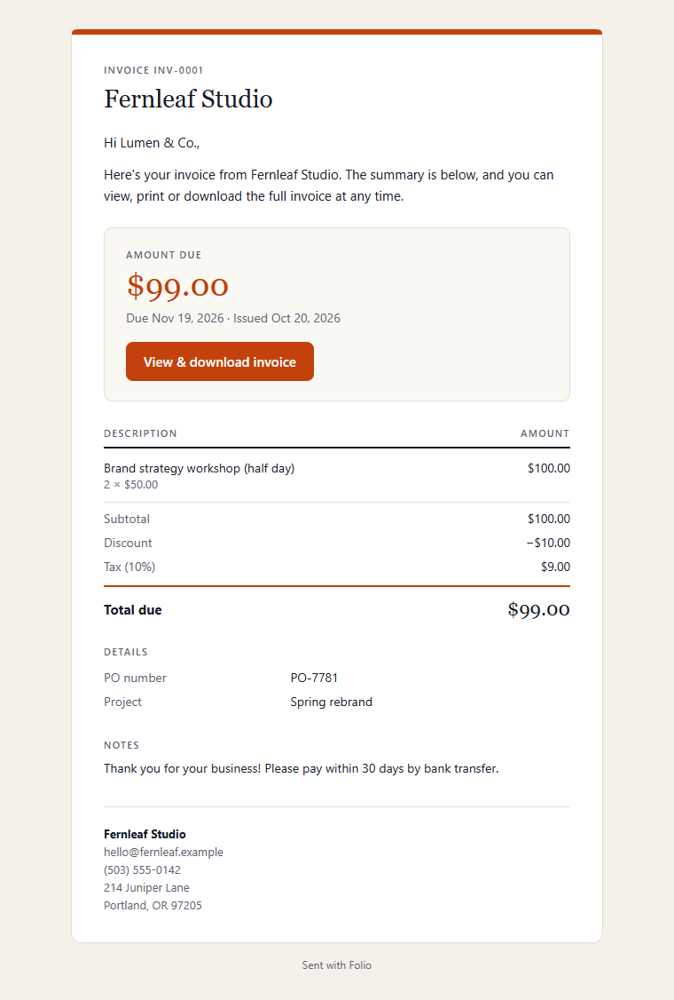

# Folio: invoice generator

A browser-based invoice editor for small businesses: fill in the details, watch a live preview,
save, print or save as PDF, and email the invoice to a customer.

**Stack:** Next.js 16 (App Router + API routes) · React 19 · TypeScript · Tailwind CSS 4 ·
React Hook Form + Zod · Supabase (Postgres) · Resend · Vitest

All data in this repository and the demo is fictional.




| Mobile: editing | Mobile: preview | The invoice email |
|---|---|---|
|  |  |  |
## What it does

| Requirement | How it's met |
|---|---|
| Invoice editor | Business and customer details, invoice number, issue and due dates (with Net 7/15/30 shortcuts), notes |
| Line items | Add, edit and remove lines (description, quantity, unit price), with Undo on remove |
| USD totals | Each line rounded to the cent, summed, fixed discount applied, then percentage tax calculated and rounded. Integer-cent math, no floating point |
| Rules | No negative quantities, prices, discounts or tax rates; discount can't exceed the subtotal |
| Check case | 2 × $50 − $10 discount + 10% tax = **$99.00** (unit test, plus a "Fill sample data" button) |
| Custom fields | Add, edit, hide/show and remove; never used in calculations |
| Live preview + PDF | Preview updates as you type; browser Print / Save as PDF prints only the invoice (no controls, no hidden fields). The PDF is named after the invoice number |
| Responsive and accessible | Works from phone to desktop; real labels, keyboard access, visible focus, readable contrast, inline errors and an error summary |
| Backend | API routes save, list, load, update and delete invoices in Supabase, and send them by email through Resend |

**Validation:** the same rules run in the browser and on the server. Fields stop accepting input at
their limits (for example, names 60 characters, email 60, description 40, invoice number 25,
quantity up to 99,999.999). Phone numbers have a country code selector (US by default) and accept
digits only, with each country's length rule.

## Setup

Requires Node 20.9 or newer.

### 1. Storage: Supabase

1. Create a project at [supabase.com](https://supabase.com).
2. In **SQL Editor**, run [`supabase/migrations/20261019000000_init.sql`](supabase/migrations/20261019000000_init.sql).
3. Copy the **Project URL** and a **Secret key** (`sb_secret_…`) into `.env.local`.

The database is only reachable from the server with the secret key; browser roles have no access.

### 2. Email: Resend

1. Create an API key at [resend.com](https://resend.com).
2. Keep `EMAIL_FROM="Folio <onboarding@resend.dev>"` unless you have a verified domain.

Without a verified domain, Resend only delivers to your own Resend account's address or its test
inbox, `delivered@resend.dev` (one click in the send dialog).

### 3. Environment variables

```bash
cp .env.example .env.local
```

Fill in `SUPABASE_URL`, `SUPABASE_SECRET_KEY` and `RESEND_API_KEY`. All keys stay on the server
(none use the `NEXT_PUBLIC_` prefix). `.env.example` contains placeholders only.

## Run

```bash
npm install
npm run dev      # http://localhost:3000
npm test         # unit tests
npm run build    # production build
```

If a key or the database table is missing, the app shows a setup screen instead of crashing.

## Decisions

- **Integer cents with BigInt** for exact money math; amounts travel as decimal strings.
- **One shared Zod schema** for the form and the API; the server always recalculates totals.
- **Line items and custom fields stored as JSON** on the invoice row: an invoice is saved and
  loaded as a whole.
- **Browser print for PDFs:** what you see is exactly what prints, with no extra PDF library.
- **Resend SDK** (not raw SMTP) for clear errors and idempotency keys, so a retry never sends
  twice. Sends are also rate-limited.
- **Hybrid data access:** pages read through a server-only module; all writes go through the
  public API routes.

## AI tools used

Built with **Claude Code** (Anthropic, Claude Opus 5.5) as a pair programmer for planning,
implementation, tests and documentation. Every change was reviewed and checked by running the
app, the unit tests, the type checker and the linter.

## Time spent: 2 h 45 min

| Phase | Time |
|---|---|
| Reading the brief, planning, choosing the stack | 15 min |
| Project setup (Next.js, Tailwind, Supabase, Resend) | 10 min |
| Money math, validation rules and unit tests | 25 min |
| Database migration and API routes | 25 min |
| Editor, live preview and print / PDF | 45 min |
| Email template and sending | 20 min |
| Invoice list, customer view, responsive and accessibility polish | 20 min |
| Final testing and README | 5 min |
| **Total** | **2 h 45 min** |

## Unfinished work

- **No login:** anyone with access to the API can view or change invoices (out of scope per the
  brief). Next step: Supabase Auth with per-user access rules.
- **Last save wins** if the same invoice is edited in two tabs.
- **No PDF attachment, reminders or payment tracking:** emails contain the invoice and a link to
  a printable page.
- **USD and US Letter only;** no logo upload or dark mode.
- **End-to-end browser tests** were run locally but aren't in the repository yet.
